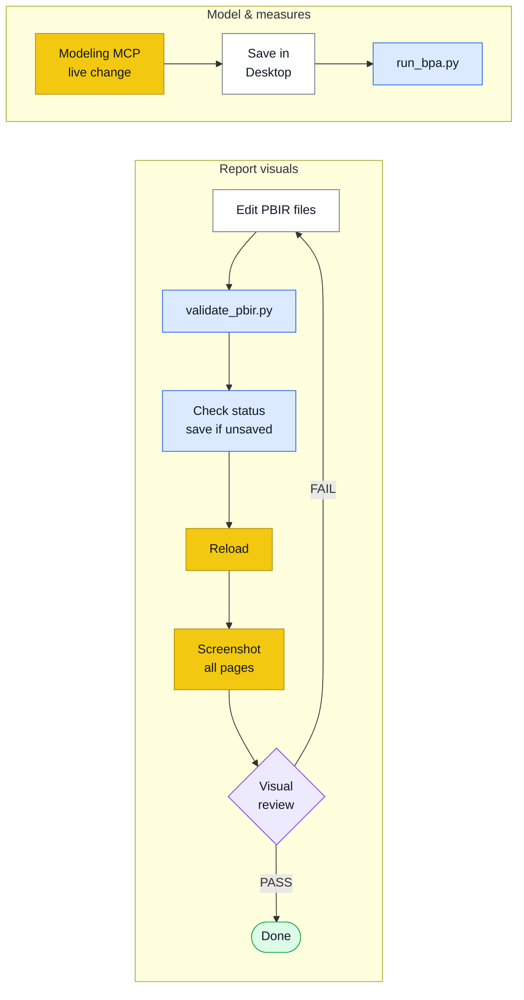

<div align="center">


# Agentic Data Kit

### Power BI development with Power BI Desktop open — driven by your AI assistant.

**Skills, scripts and an independent visual reviewer that let Claude Code, Copilot, OpenCode,
Cursor and Antigravity edit your model and report while you watch them change in Desktop.**

[](LICENSE)


```bash
npx @luccapinto/agentic-data-kit@latest init
```

**1 agent · 9 skills · 3 workflows · 5 targets**

</div>

---

## Contents

- [🧠 What it is](#-what-it-is)
- [📈 The Power BI loop (Desktop open)](#-the-power-bi-loop-desktop-open)
- [🚀 Install](#-install)
- [✅ Prerequisites for the Power BI loop](#-prerequisites-for-the-power-bi-loop)
- [🎯 What's inside](#-whats-inside)
- [🧪 Validation scripts](#-validation-scripts)
- [🔄 Multi-tool sync](#-multi-tool-sync)
- [🤝 Contributing](#-contributing)
- [🙏 Credits & references](#-credits--references)
- [📄 License](#-license)

---

## 🧠 What it is

Generic LLMs don't know *your* standards, but they already write clean code. So this kit captures
only what a model can't supply on its own: how Power BI projects are laid out (PBIP, TMDL, PBIR),
how to drive Power BI Desktop while it is open, real quality gates (Best Practice Analyzer, PBIR
validation), and your brand. Power BI is the flagship; the kit also ships dbt naming conventions,
documentation templates and presentation builders (HTML decks, editable PPTX). Everything is
authored once in `.agent/` and compiled into each assistant's native format.

---

## 📈 The Power BI loop (Desktop open)

You keep Power BI Desktop open on the `.pbip`. The assistant changes the model live and the
report on disk, then reloads Desktop and looks at the result.



<sub>Yellow: acts on the open Desktop (Modeling MCP, `powerbi-report-author preview`) · Blue: validation gate · Purple: independent review by `pbi-visual-reviewer` (read-only, fresh context).</sub>

Visual loop in order: **edit PBIR → `validate_pbir.py` → confirm Desktop has no unsaved changes
(`powerbi-report-author preview <folder> --host desktop --status`, `details.hasUnsavedChanges` must
be `false`) → `--reload` → `--screenshot <dir> --all-pages` → `pbi-visual-reviewer`.**

**Three pitfalls**

1. **Reload discards unsaved Desktop changes.** Check the status first; save in Desktop if needed.
2. **Reload only covers the report.** Model and measure changes go through the Modeling MCP, not
   through file reload.
3. **An edited theme may not reload.** Rename the theme file (and its reference) to force a pick-up.

Details: [`desktop-bridge.md`](.agent/skills/pbi-report-layer-pbir/references/desktop-bridge.md)
and [`modeling-mcp.md`](.agent/skills/pbi-semantic-layer-tmdl/references/modeling-mcp.md).

**Desktop-closed alternative.** No Desktop Bridge, an older Desktop, or CI? The disk-only path
stays supported: edit TMDL/PBIR on disk, validate with the scripts, then reopen the project in
Desktop. It is documented in
[`pbi-report-layer-pbir` › Alternative: Desktop closed](.agent/skills/pbi-report-layer-pbir/SKILL.md#alternative-desktop-closed)
and [`pbi-semantic-layer-tmdl` › Alternative: Desktop closed](.agent/skills/pbi-semantic-layer-tmdl/SKILL.md#alternative-desktop-closed-no-mcp-older-desktop-ci).

---

## 🚀 Install

```bash
npx @luccapinto/agentic-data-kit@latest init
```

Pick your assistant in the prompt, or skip it with `--target`:

```bash
npx @luccapinto/agentic-data-kit@latest init --target cursor
```

| `--target` | Installs | Agent (`pbi-visual-reviewer`) |
|---|---|---|
| `antigravity` | `.agent/` (source of truth) + `scripts/sync_agents.py` | `agents/` — Antigravity has no subagents: run the review in a fresh chat |
| `copilot` | `.github/` (agents · skills · prompts · `copilot-instructions.md`); your other `.github` files are left alone | `agents/pbi-visual-reviewer.agent.md`, `tools` mapped to Copilot names |
| `claude` | `.claude/` (agents · skills · commands · workflows · `CLAUDE.md`) | native subagent |
| `opencode` | `.opencode/` (agents · skills · commands) + root `AGENTS.md` | `mode: subagent`, edit/bash denied |
| `cursor` | `.cursor/` (`rules/*.mdc` · commands · skills) | none — run the review in a fresh chat with only the screenshots, spec and PBIR |

OpenAI Codex reads the root `AGENTS.md`. Instructions are written in English; the assistant
replies in **your** language.

---

## ✅ Prerequisites for the Power BI loop

| Need | Why |
|---|---|
| **Power BI Desktop** (Windows), with *File > Options > Security > Desktop Bridge → "Enable external tool access…"* turned on | The Bridge lets the CLI reload and screenshot the open report |
| **Node 20+** | Runs the installer, the report CLI and the Modeling MCP |
| `npm i -g @microsoft/powerbi-report-authoring-cli` | `powerbi-report-author` (validate, preview, reload, screenshot); also installs the lower-level `powerbi-desktop` bridge CLI |
| **Power BI Modeling MCP** registered in your MCP client (`npx -y @microsoft/powerbi-modeling-mcp@latest --start`), then "Connect to '&lt;file&gt;' in Power BI Desktop" | Live model and measure changes |
| *(optional)* **Tabular Editor 2** | Exact BPA results; without it the Python fallback runs |
| **Python 3.9+** | Validation scripts (standard library only) |

Without these you still get the Desktop-closed path and the scripts' fallbacks.

---

## 🎯 What's inside

| | Count | What it is |
|---|:---:|---|
| 🤖 **Agent** | **1** | `pbi-visual-reviewer` — independent review of report screenshots |
| 🧩 **Skills** | **9** | On-demand knowledge modules that self-activate by description |
| 🔄 **Workflows** | **3** | Slash commands: `/plan`, `/validate-pbi`, `/document-dashboard` |
| 🎯 **Targets** | **5** | Antigravity · Copilot · Claude Code · OpenCode · Cursor |

**Agent.** An agent only exists if it imposes something the model can't impose on itself:
restricted tools, an independent fresh-context review, a different model, or an automatic trigger.
`pbi-visual-reviewer` has read-only tools (`Read`, `Grep`, `Glob`) and never sees the author's
reasoning. It checks screenshots + spec + PBIR for overlap, clipped text, empty/error visuals,
alignment, theme consistency and titles, and returns PASS/FAIL per page and per visual.

**Skills**

| Skill | Use it for |
|---|---|
| `pbi-semantic-layer-tmdl` | Author Power BI semantic models (TMDL) and drive them live through the Modeling MCP |
| `pbi-report-layer-pbir` | Edit reports as code (pages, visuals, themes) and run the Desktop reload/screenshot loop |
| `pbi-quality-rules` | Real Best Practice Analyzer via Tabular Editor 2, with a Python fallback |
| `dbt-modeling-conventions` | dbt CTE structure, `stg_`/`dim_`/`fct_`/`mart_` naming, keys and tests |
| `documentation-templates` | Runbooks, data dictionaries, metric definitions, ADRs, Power BI catalog |
| `applying-visual-identity` | Apply a company brand from a `DESIGN.md` |
| `building-html-presentations` | Decks, scrollable decks, interactive sites, consulting PDFs + chart cookbook |
| `generating-pptx` | Native, editable PowerPoint via python-pptx |
| `creating-agents-and-skills` | Decide whether to add an agent, skill or nothing — and keep every tool folder in sync |

**Workflows**

| Command | What it does |
|---|---|
| `/plan` | Writes `docs/PLAN-<slug>.md` for a data task — plan only, no code |
| `/validate-pbi` | Runs the BPA and the PBIR check on a PBIP project |
| `/document-dashboard` | Generates Markdown documentation for a PBIP project |

---

## 🧪 Validation scripts

Validation lives in scripts inside the skills, not in agents. All three accept
`--format text|json`; exit code `0` = no errors, `1` = errors found, `2` = usage or tool failure.

| Script | What it does |
|---|---|
| `.agent/skills/pbi-quality-rules/scripts/run_bpa.py <model>` | Real BPA through the Tabular Editor 2 CLI; falls back to `bpa_fallback.py` if TE2 isn't found |
| `.agent/skills/pbi-quality-rules/scripts/bpa_fallback.py <model>` | The same 10 rules of `bpa-rules.json` re-implemented in Python over TMDL (less exact) |
| `.agent/skills/pbi-report-layer-pbir/scripts/validate_pbir.py <path>` | Runs `powerbi-report-author validate` when installed; otherwise a structural PBIR check |

Python 3.9+, standard library only. Run the repo's own tests with `npm test`.

---

## 🔄 Multi-tool sync

`.agent/` is the **single source of truth**. One script compiles it into every tool's native format:

```bash
python3 scripts/sync_agents.py          # regenerate .claude/ .github/ .opencode/ .cursor/ AGENTS.md
python3 scripts/sync_agents.py --check  # exit 1 if generated folders are stale (used by CI)
```

```text
.agent/                ← edit here
├── agents/            # 1 independent reviewer
├── skills/            # 9 on-demand knowledge modules (+ scripts, references)
├── workflows/         # 3 slash commands
└── rules/             # always-on rules (rules.md)

.claude/  .github/  .opencode/  .cursor/  AGENTS.md   ← generated (do not edit)
```

The generated folders ship in the package because `init` installs one folder per tool.

---

## 🤝 Contributing

See **[CONTRIBUTING.md](CONTRIBUTING.md)**: author in `.agent/` only, sync, test — and apply the
agent-survival rule before adding anything. Release history is in [CHANGELOG.md](CHANGELOG.md).

---

## 🙏 Credits & references

- [Power BI Desktop Bridge](https://learn.microsoft.com/en-us/power-bi/developer/agentic/power-bi-desktop-bridge-overview)
- [Power BI Report skill](https://learn.microsoft.com/en-us/power-bi/developer/agentic/power-bi-report-skill-overview)
- [Power BI Authoring MCP server](https://learn.microsoft.com/en-us/power-bi/developer/mcp/power-bi-authoring-mcp)
- [microsoft/skills-for-fabric](https://github.com/microsoft/skills-for-fabric/tree/main/plugins/powerbi-authoring) (MIT) — skill `powerbi-report-cli`
- `DESIGN.md` follows the Google Labs spec (Apache-2.0). See [THIRD_PARTY_NOTICES.md](THIRD_PARTY_NOTICES.md).

---

## 📄 License

**MIT** © [Lucca Pinto](https://github.com/luccapinto) — repository:
[luccapinto/agentic-data-kit](https://github.com/luccapinto/agentic-data-kit)

<div align="center"><sub>Built for data teams who'd rather ship than re-explain the basics.</sub></div>
